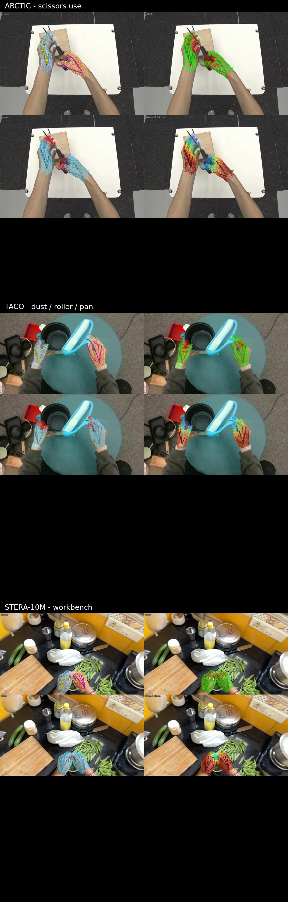

# EgoFound3R paper-style visual examples

These examples use the paper's default 2-second window and global stride `s=5`.
The four panels are Geometry, Visibility, Contact, and metric contact Distance (0–50 mm).
All examples use the official EgoFound3R and VGGT-Omega checkpoints with 778-vertex overlays.

[Play the concatenated video montage](montage.mp4)

| Example | Frames | Forward time | Peak reserved VRAM |
|---|---:|---:|---:|
| ARCTIC · scissors use | 60 | 1.052 s | 6.15 GiB |
| TACO · dust / roller / pan | 59 | 1.042 s | 6.09 GiB |
| STERA-10M · continuous workbench capture | 30 | 1.061 s | 6.09 GiB |

Full tensors, summaries, validations, and source clips remain in each remote result directory recorded in `manifest.json`.
